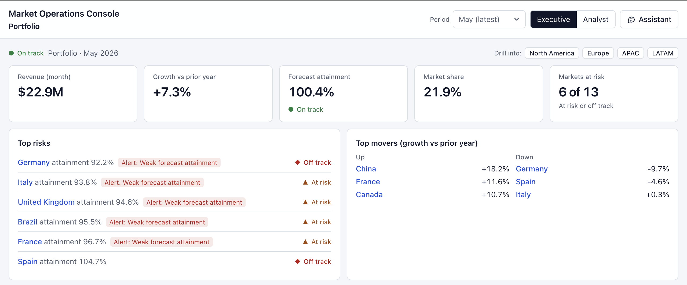
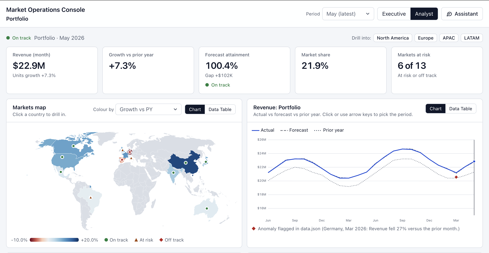
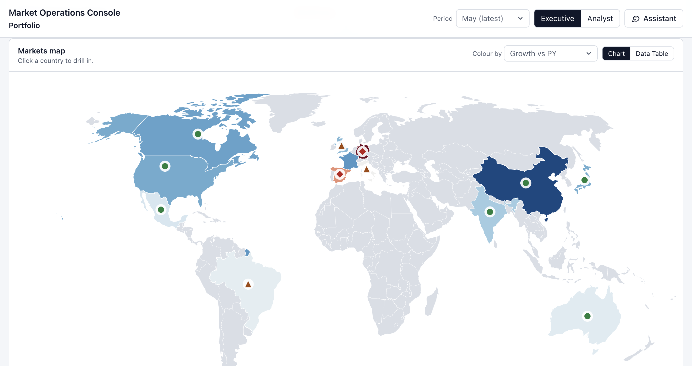
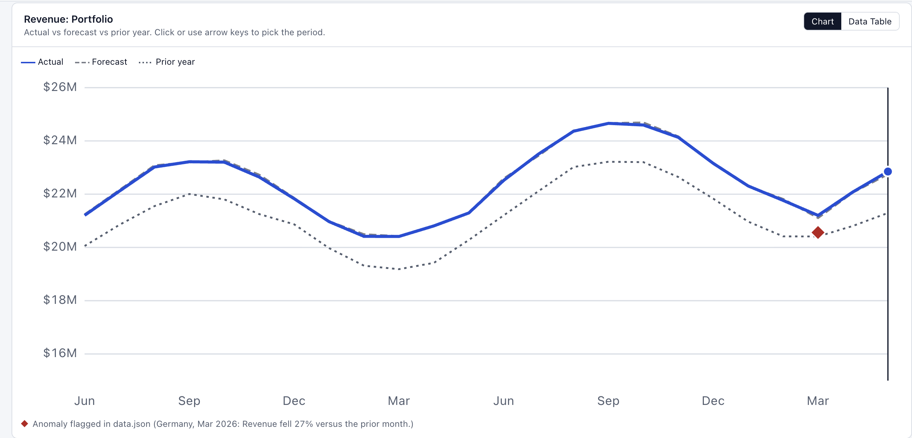
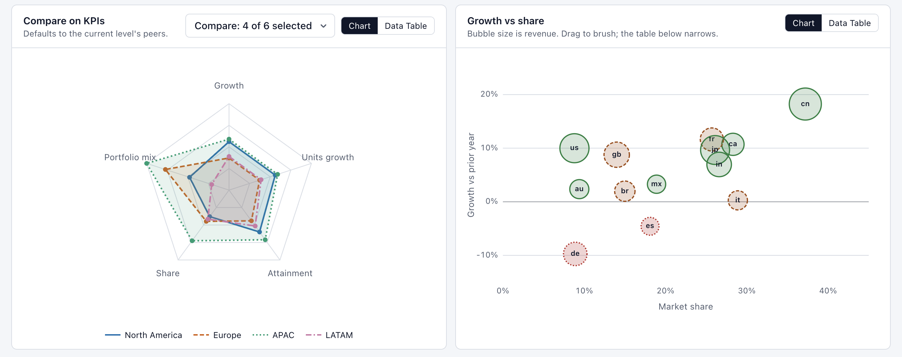
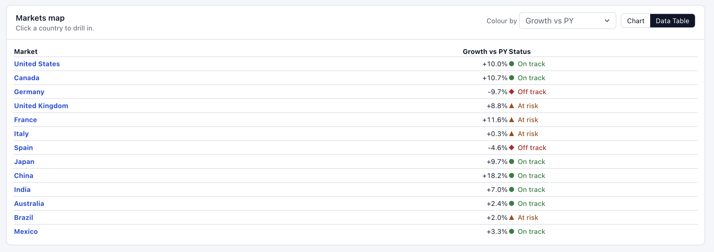
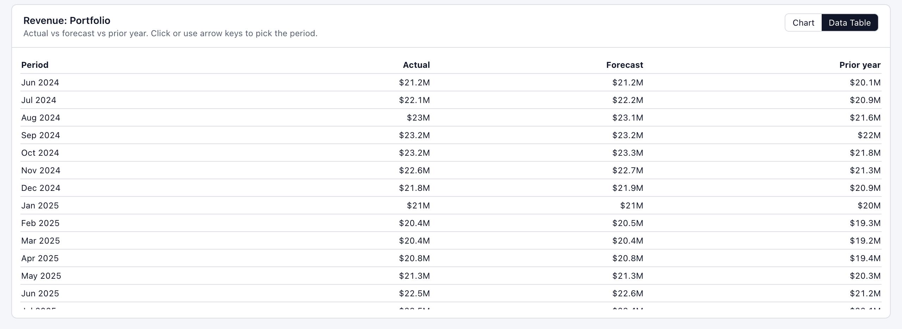
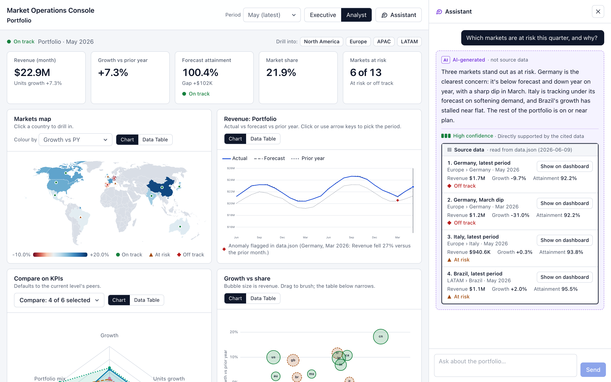
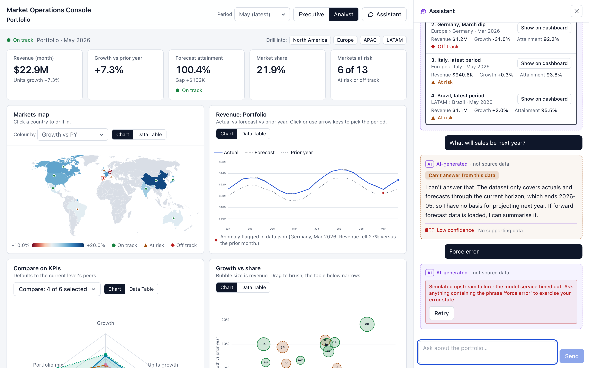
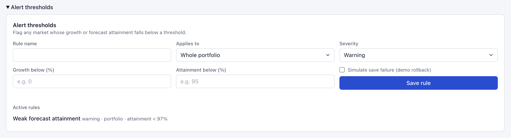

# Market Operations Console

A dashboard over a portfolio of 4 products sold in 13 markets, with a streaming assistant that answers questions about the data and shows where its answers come from.

- Live: https://market-console-rho.vercel.app/
- Repo: https://github.com/jagdishlove/market-console

## Screenshots

Executive view: KPI strip, top risks, top movers.



Analyst view: the same data with the map and time series side by side.



Map coloured by growth. Status is also shown as a shape on each country.



Time series: actual, forecast, prior year, with the anomaly marked.



Radar and growth-vs-share scatter.



Every chart has a table version. Map and time series shown here.




Assistant: an AI answer (dashed card) with its source data underneath (solid box, figures read from the dataset), a confidence cue, and a "Show on dashboard" button for each source.



The same panel after an abstention ("Can't answer from this data", no sources) and a forced error with a Retry button.



Alert rule form.



## 1. Setup

```bash
npm install
npm run dev          # http://localhost:3000
npm test             # 36 unit + component tests (Vitest, Testing Library)
npm run test:e2e     # 4 Playwright happy paths, builds and serves on :3100
npm run typecheck && npm run lint
```

Node 20+. No env vars. `CHAT_TOKEN_DELAY_MS` (default 35) changes how fast the fake stream types.

To try the assistant, open `/?mode=analyst&assistant=open` and click the suggested prompts. They hit each fixture: a normal answer, a low-confidence one ("forecast miss"), an abstention ("next year"), a long one ("full portfolio summary") and an error ("force error").

## 2. Architecture

### What came with the brief

The starter pack had `data.json`, `fixtures.json`, `CONTRACT.md` and a reference chat route. I did not write those, except the route, which I re-implemented.

| Pack file | Where it is | What I did with it |
| --- | --- | --- |
| `data.json` | `data/data.json` | Validated with Zod (`lib/schema.ts`). Every number on screen is recomputed from the 1,560 `series` rows, so every level of the hierarchy uses the same definitions. I only take `status`, `sharePct` and `anomalies` from the pack's market KPIs. |
| `fixtures.json` | `data/fixtures.json` | The fake model. A question is lowercased and matched by substring against each fixture's keywords, first match wins (`lib/fixtures.ts`). |
| `reference/chat-route.ts` | `app/api/chat/route.ts` | Same behaviour, plus request validation, abort handling and a short delay before the first token. |
| `CONTRACT.md` | `CONTRACT.md` | The stream format. I typed it once as `StreamEventSchema` and use it on both the server and the client. |

A few things in the data surprised me:
- KPIs exist for the latest month only, so the KPI strip shows one month and follows the period picker.
- Market share exists per market, not per month. Region and portfolio share is a revenue-weighted average. At product level I show "—" rather than make something up.
- The pack's precomputed revenue and attainment differ slightly from the series for some markets (growth matches). A test pins the tolerance, and another checks that my status rule (growth below 0 is off track, attainment below 97% is at risk) gives the pack's status for all 13 markets.
- Citations are pointers (market, region, product, period), not claims with numbers. I can check that a pointer resolves. I cannot check a number inside the answer text.
- The assistant's text says "three markets" are at risk while the KPI strip says 6 of 13. The text comes from the fixtures and the KPI is computed, which is one more reason the UI keeps them visibly apart.

### Component and data flow

```
app/page.tsx (server)     validates the dataset, puts it in the React Query cache
  └─ Dashboard (client)
       ├─ useViewState()  URL <-> selection, period, mode, filters, chat open
       ├─ useIndex()      buildIndex(): hierarchy + KPIs for any node and period
       ├─ charts/*        SVG drawn with d3 scales/shapes, each inside a ChartFrame
       ├─ dashboard/*     KPI strip, exec summary, analyst table, alert form
       └─ ChatPanel
            ├─ useChat()  reducer + fetch stream + AbortController
            └─ lib/sse.ts incremental parser, events validated with Zod

app/api/data       GET        the dataset (cache headers set)
app/api/chat       POST       SSE stream of a fixture
app/api/alerts     GET, POST  alert rules, kept in memory
app/api/telemetry  POST       web-vitals and error sink (logs only)
```

The main idea is one domain model. Everything is a node (`portfolio`, `eu`, `de`, `de.veltrix`), and `buildIndex` can give the series or the KPIs for any node and month. The map, radar, time series, table, KPI strip and the assistant's source cards all call the same functions, so a citation shows exactly the numbers the dashboard shows.

### Server state and client state

| What | Where | Why |
| --- | --- | --- |
| Dataset, alert rules | TanStack Query | Caching and optimistic updates with rollback. |
| Selection, period, mode, brush, comparison, chat open | The URL | Links are shareable and back/forward works for free. No second copy of the state. |
| Hover, drag, form fields, chat transcript | `useState`, `useReducer`, react-hook-form | Not worth sharing. |

## 3. Productionising

What is wired up in the repo:
- **Performance:** the dataset is fetched on the server and hydrated, so there is no client waterfall. Production build: 179 kB first-load JS for the page. The map topology is code-split. Tokens are batched per animation frame, so streaming does not re-render more than once per frame. `/api/data` sends `stale-while-revalidate` cache headers. System fonts only, so no font loading cost.
- **Loading:** a skeleton page with a thin progress bar (`components/ui/page-loading.tsx`) is the `Suspense` fallback.
- **Observability:** `useReportWebVitals` posts to `/api/telemetry`. A route-level `error.tsx` and a per-widget `ErrorBoundary` report errors, so one broken chart does not take down the page. The endpoint only logs. Switching to Sentry or Datadog means changing `lib/telemetry.ts`.
- **Resilience:** Zod at every boundary (dataset, stream events, alert API), abort-safe streaming, partial-answer states, retry. Model text is never rendered as HTML (see section 4).
- **Build, serve, cache:** Next.js production build, deployed on Vercel. The page is prerendered with the dataset in the HTML. API routes are dynamic, and only `/api/data` is cached.
- **CI/CD:** `.github/workflows/ci.yml` runs typecheck, lint, unit tests and Playwright on every PR and on pushes to `main`. Deploys go through Vercel's Git integration (a preview for each PR, production from `main`).

What I would add: bundle-size and Lighthouse budgets in CI, source maps sent to an error tracker, a CSP with nonces, rate limiting and auth on `/api/chat`, a feature flag for the assistant, and SSE heartbeats for proxies.

## 4. Front-end approach and decisions

**Framework: Next.js 15 (App Router), React 19, strict TypeScript.** I wanted the mock SSE endpoint next to the UI, server-side prefetch with hydration, and an easy deploy. Remix and TanStack Start would also have worked. Next was the lowest-risk option for me. TypeScript is strict with no `any`, and types come from the Zod schemas (`z.infer`).

**Components and tokens: Tailwind with CSS variable tokens, no component library.** Colours are tokens in `globals.css` mapped in `tailwind.config.ts`, and components don't use raw colours. There are only about ten primitives, and plain `<select>` and `<details>` were more accessible than a library's versions. The cost is that I have no ready-made combobox or popover, so there is no command palette.

**Streaming: `fetch` and `ReadableStream`, not `EventSource`.** `EventSource` can only do GET, and I need to send the question in a POST body. `lib/sse.ts` buffers across chunk boundaries and drops any event that fails the schema. Tokens are batched once per animation frame. Stop calls `abort()`, and the server also stops when the request is aborted.

**Data viz: d3 for maths, hand-written SVG for drawing.** The brief needs a map, a radar and a brushable scatter, each with keyboard and ARIA support. I found that easier to control in plain SVG than inside a chart library. d3 does scales, shapes and projections only. The world topology is code-split. The cost is that I own the layout and axes.
- Map: diverging colours for growth and attainment, sequential for revenue and share. Status is also shown as a shape (circle, triangle, diamond).
- Radar: fixed domain per axis, so a polygon means the same thing when the selection changes.
- Time series: actual (solid), forecast (dashed), prior year (dotted), anomalies as diamonds.
- Extra chart: growth versus share scatter with a brush. I chose it over a heat map because it shows two measures and size at once.

**Server and client state: TanStack Query plus the URL, no global store.** I considered Zustand or Redux for the view state and decided against it. The URL has to hold that state anyway for shareable links, and a store would be a second copy to keep in sync.

**Coordinated views and URL state.** Example: `?focus=de&period=2026-03&mode=analyst&map=attainment&compare=de,fr&growth=-5..10&share=5..20&assistant=open`. Drilling and period changes use `push`, so back works. Brush and toggles use `replace`. Bad values fall back to defaults. Every selection (map, scatter, table row, breadcrumb, citation) goes through the same `update({ sel })`, so one click updates every view.

**Executive and analyst modes** are two arrangements of the same components. Executive shows the KPI strip, top risks, top movers, map and trend. Analyst adds the radar, scatter, sortable table and a larger KPI strip. The alert thresholds panel is in both, because the saved rules drive the flags in both modes. It starts open in analyst and collapsed in executive.

**Forms: react-hook-form and Zod.** One schema (`AlertRuleInputSchema`) validates the form and the API. It needs at least one threshold and range-checks each. Saving is optimistic, so the rule appears dimmed at once and is removed if the server fails. The "Simulate save failure" checkbox exists to show that. Saved rules show up in the dashboard as "Alert: …" flags.

### Making the AI output trustworthy

1. **AI and real data look different.** The answer sits in a dashed, tinted card labelled "AI-generated · not source data". Under it is a solid-bordered "Source data" block labelled with the dataset's `generatedAt`. Every figure in that block is read from the dataset, never from the answer text.
2. **Citations are resolved, not trusted.** Each pointer is looked up in `data.json` (`lib/citations.ts`) and shown with the entity's revenue, growth, attainment and status, plus a "Show on dashboard" button. A pointer that does not resolve is flagged in red.
3. **Confidence is text plus a three-segment meter**, never colour alone. Abstentions get their own card and no sources. Stopped or failed answers keep their partial text, are marked unverified, and show no sources.

Model text is never rendered as HTML. It is split into paragraphs and shown as React text. A test checks that `` appears as plain text.

## 5. Accessibility

Done:
- Skip link, landmarks, native controls, visible focus ring.
- Every chart has a "Data table" toggle.
- Map countries and scatter bubbles are focusable buttons with full labels. Tooltips show on hover and on focus.
- The time series works with the arrow keys, Home and End, with a live readout.
- The brush has number inputs, so it works without a mouse.
- Colour is never the only signal (status shapes, dash patterns, confidence text).
- `aria-sort` on the table, form errors linked with `aria-describedby`, and a polite status line in the chat ("thinking / answering / complete"). Individual tokens are not announced, since that would be unusable.
- `prefers-reduced-motion` is respected.

Not done:
- No automated axe run and no screen reader pass (VoiceOver or NVDA).
- Contrast was checked by eye against the token palette, not measured.
- No dark or high-contrast theme.
- Map and radar tab order is plain DOM order.
- The layout collapses to one column on a phone and I checked it at 375 px, but I did not design a separate mobile experience.

## 6. Testing

- **Unit (Vitest):** my KPIs and status rule against the pack's, hierarchy sums, alert evaluation, URL round trip and bad input, SSE parsing with split chunks and malformed events, and schemas.
- **Fixtures:** the brief's example questions pick the intended fixture, all four kinds exist, every citation in every fixture resolves, and abstentions carry no citations.
- **Component (Vitest and Testing Library):** the chat panel against a mocked streaming `fetch` (stream, sources, abstention, error with retry, stop, no HTML), and the alert form (validation, optimistic add, rollback).
- **End to end (Playwright, 4 tests):** drill down with back/forward and reload; keyboard map selection; ask a question, check sources, jump to the dashboard, then get an abstention; save an alert.

Why two tools: they test different layers. Vitest runs in a simulated DOM with no server, takes about two seconds, and points at the exact function that broke. Playwright drives a real browser against the built app, so it proves the pieces work together (real routes, the real stream, the URL, back and reload). I wanted many fast tests and a few slow ones.

Skipped on purpose: visual regression, checks on chart SVG geometry (brittle), load tests. Not covered: dragging the brush in e2e (I checked it by hand), and any browser other than Chromium.

## 7. Key technical decisions

1. Citations are resolved against the dataset, and real figures are shown beside the AI text, because the fixtures cannot be checked numerically.
2. The URL is the one store for view state, rather than Zustand or Redux. The price is that everything has to be serialised and validated, which I do in one file.
3. One hierarchy model (node plus index) instead of separate code for each level.
4. Hand-built SVG charts, for control over accessibility.
5. KPIs cover one month, the selected period, as in the pack. "This quarter" in the fixtures is read as the latest period.

## 8. Engineering standards

Followed: strict TypeScript and no `any`, schemas as the single source of types, string-literal unions instead of enums, small modules, pure logic kept apart from components so it can be tested without a DOM, tokens instead of raw colours, native HTML before ARIA, comments only where the reason is not obvious, and a CI gate.

Skipped: Storybook, Prettier and commit hooks, i18n (everything is `en-US` and USD), and a feature-folder layout (the app is small enough for `components/<area>`).

## 9. How I used AI tools

I used Claude Code for most of the build: the project setup, the code, the tests and a first draft of this README. I did not use sub-agents, templates or custom commands. It was one long conversation, and the starter pack was the source of truth.

**What I decided before the code.** I gave it the brief and told it to work as a senior developer, do what the brief asks, use best practices and not over-engineer. The big choices were set early: Next.js with strict TypeScript, the URL as the home for view state, one hierarchy model, and the pack's data and stream format used as given, with no real backend.

**What I did myself.** I ran the app after each change and reviewed every screen. I asked for plain-language explanations of the task, the starter pack, each file and the TypeScript conventions (interface versus type versus enum) until I understood them, so I could defend the code. I also made the screenshots and reviewed my own demo.

**Things the AI got wrong that I caught:**
- It first built everything on a made-up dataset because it had not seen the starter pack. I pointed at the pack and had it ported.
- Clicking a map country or a scatter bubble drew a focus rectangle around it. I asked for it to go and for a hover colour instead.
- The page scrolled past its own content, caused by a hidden element positioned outside the page.
- The dropdown arrows were misaligned, and charts had no tooltips.
- It wrote about 95 comments that read like explanations for me. I asked for them to be cut, and about 17 remain, each saying why and not what.

The type checker and the tests caught other things: a server and client module boundary that broke the build, a form-resolver typing mismatch, and partial text being lost when a stream ended early.

**My rules:** build only what the brief asks; check in the browser and not only in the tests; understand every file well enough to explain it; remove what is not needed.

## 10. What I would do with more time

- Run axe in CI and do a real screen reader pass.
- Design the layout for phones properly. It works at phone width today but I did not tune it.
- Make the assistant aware of what the dashboard is showing. The contract sends only the question today.
- A heat map next to the scatter, a command palette, live mode, and a virtualised table (the table has about 50 rows, so it was not needed).
- Per-market currency. The dataset has one currency, so everything is shown in USD.
- A zoomable map with an inset for small markets.
- Anomalies at product level. The data only records them per market.
- Persist alert rules. They live in memory and reset on restart.
